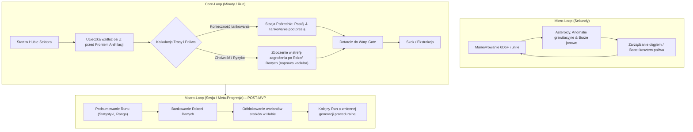

# GAMEPLAY.MD - AD ASTRA GAME DESIGN & CORE LOOP

## 1. HIGH CONCEPT & EXPERIENCE GOALS
**AdAstra** to kosmiczny survival-eksplorator w formule roguelike (krótkie runy trwające kilka minut). Gracz wciela się w pilota statku badawczo-ewakuacyjnego uciekającego z zapadającego się sektora przestrzeni kosmicznej przed **Frontem Anihilacji** (falą niszczycielskiej energii).

Gra łączy precyzyjny pilotaż arcade/6DoF z napięciem wynikającym z zarządzania zasobami (paliwo, kadłub) oraz presją nieubłaganie nadciągającej ściany zagłady.

Długość runu nie jest celem samym w sobie – wynika z układu sektora (sekcja 2.5) i jest mierzona podczas blockoutu.

> Dokument opisuje aktualne założenia projektowe. Reguły i liczby są hipotezami weryfikowanymi w playtestach i mogą się zmieniać w trakcie prac.

---

## 2. TRÓJPOZIOMOWY GAMEPLAY LOOP

### 2.1. Pętla Mikro (Sekundy)
* Pilotaż statkiem w przestrzeni 3D oparty na fizyce.
* Omijanie dryfujących asteroidów (zderzenie przy dużej prędkości uszkadza kadłub), unikanie piorunów burzy jonowej i przyciągania anomalii grawitacyjnych.
* Balansowanie użyciem boostu (prędkość ucieczki vs ponad dwukrotnie szybsze spalanie paliwa).

### 2.2. Pętla Rdzenna (Minuty / Pojedynczy Run)
1. **Start:** Wylot ze stacji bazowej w kierunku bramy skokowej (Warp Gate) w autorskim sektorze. Gracz startuje z pełnym bakiem i nieuszkodzonym kadłubem.
2. **Nawigacja i Presja Czasu:** Warp Gate jest widoczna z daleka dzięki świecącemu beaconowi. HUD pokazuje paliwo, kadłub, dystans do bramy, dystans do Frontu Anihilacji oraz znacznik stacji pośredniej. Za plecami gracza przesuwa się ze stałą prędkością **Front Anihilacji**.
3. **Wymuszony Postój:** Pełny bak nie wystarcza na przelot całego sektora – bez tankowania na stacji pośredniej nie da się dolecieć do bramy.
4. **Zarządzanie Ryzykiem:**
   - **Stacja Pośrednia:** Gracz musi zatrzymać się w strefie stacji; paliwo napływa, dopóki statek stoi. Gracz sam decyduje, kiedy odlecieć – pełny bak kosztem zbliżającej się fali albo wcześniejszy odlot z niepełnym bakiem.
   - **Strefy Zagrożenia:** Gracz decyduje, czy zboczyć z trasy w głąb burzy jonowej, pola asteroid lub na krawędź anomalii grawitacyjnej, by przechwycić **Rdzenie Danych (Data Cores)** naprawiające kadłub.
5. **Ekstrakcja:** Wlot do bramy Warp Gate rozpoczyna procedurę skoku (przechwycenie statku i autoryzacja w terminalu, patrz 4.4). Poprawna autoryzacja kończy run sukcesem.

### 2.3. Pętla Makro (Meta-Progresja i Persystencja) – POST-MVP
* Docelowo: dowiezione Rdzenie Danych są bankowane i służą do odblokowania predefiniowanych wariantów statku (np. Lekki Zwiadowca, Ciężki Frachtowiec) lub ulepszeń.
* Proceduralny generator sektora zastąpi autorski sektor po ustabilizowaniu pętli rdzennej.

### 2.4. Zakres MVP
MVP to pętla rdzenna (2.2) zbudowana na mechanikach z sekcji 4 i trzech istniejących modułach zagrożeń (pole asteroid, burza jonowa, anomalia grawitacyjna) plus Front Anihilacji.

Zakres nie jest zamknięty. Nowe mechaniki i lokacje (minigry, ulepszenia statku, nowe zagrożenia – w tym wrogie AI i walka, alternatywne trasy) są mile widziane, ale wchodzą dopiero wtedy, gdy pętla „start → stacja → brama” jest grywalna i przetestowana. Pomysły czekają jako taski w kolumnie *Ideas* na boardzie projektu.

### 2.5. Układ Sektora (Blockout)
Sektor to jedna linia krytyczna wzdłuż osi Z ze swobodą manewru na boki. Strefy ryzyka z Rdzeniami Danych leżą obok trasy jako opcjonalne zboczenia.

**Metoda:**
1. **Metryki najpierw.** Prędkość przelotowa i boostu, zasięg na pełnym baku, prędkość Frontu Anihilacji i czas tankowania. Każdy odstęp w sektorze wyraża się w tych jednostkach, nie „na oko”.
2. **Sektor jako sekwencja beatów.** Każdy beat ma rolę i docelowe napięcie; tabela poniżej opisuje zamierzony rytm runu, a nie konkretne odległości.
3. **Beat = podmienialny segment.** Każdy beat to moduł (lokacja lub zagrożenie) ustawiony na osi Z. Nowa mechanika to później podmiana lub dołożenie segmentu, a nie przebudowa sektora. Sektora nie buduje się pod mechaniki, których jeszcze nie ma – bez pustych placeholderów i rezerwowania przestrzeni „na zapas”.
4. **Blockout → playtest → strojenie liczb → dopiero dekoracja.**

**Tabela beatów (MVP):**

| Beat | Rola | Moduł | Napięcie |
|------|------|-------|----------|
| Start | Nauka lotu; fala daleko w tyle | Hub | Niskie |
| Odcinek 1 | Nauka zderzeń; pierwszy rdzeń na krawędzi pola jako pierwsza pokusa | Pole asteroid | Średnie |
| Stacja | „Odpoczynek” pod presją fali; decyzja, ile zatankować | Stacja pośrednia | Rosnące |
| Odcinek 2 | Test umiejętności; burza i anomalia obok trasy, rdzenie w ich wnętrzu | Burza jonowa, anomalia grawitacyjna | Wysokie |
| Finisz | Brama w zasięgu wzroku; wyścig z falą o resztki paliwa | Warp Gate | Szczyt |

---

## 3. WARUNKI ZWYCIĘSTWA I PORAŻKI

### 3.1. Zwycięstwo (Run Complete)
* Wlot statkiem w bramę **Warp Gate** i ukończenie procedury skoku (4.4), zanim kadłub zostanie zniszczony.
* Ekran podsumowania (MVP): czas ucieczki (od startu do poprawnej autoryzacji), pozostały kadłub %, pozostałe paliwo %, najmniejszy dystans do Frontu Anihilacji w trakcie runu, przycisk Restart.
* Docelowo podsumowanie rozszerzy się o liczbę dowiezionych Rdzeni Danych, rangę pilotażu oraz bankowanie rdzeni.

### 3.2. Porażka (Game Over)
* **Destrukcja Kadłuba:** Zderzenia z asteroidami przy dużej prędkości, uderzenia piorunów w burzy jonowej lub obrażenia od Frontu Anihilacji.
* **Pochłonięcie przez Front Anihilacji:** Wpadnięcie w strefę niszczącej energii (gwałtowne obrażenia redukujące kadłub do zera).
* **Wytracenie Ciągu (Brak Paliwa - Stan Dead-Stick):**
  - Gdy paliwo się kończy, silniki główne oraz silniki manewrowe gasną. Gracz traci kontrolę nad lotem i rotacją, a statek wytraca prędkość i zatrzymuje się.
  - Sam brak paliwa **nie wywołuje natychmiastowego Game Over** – porażka następuje, gdy unieruchomiony statek dogoni Front Anihilacji. Przy obecnym modelu lotu ratunkiem jest praktycznie tylko wyczerpanie paliwa już wewnątrz strefy stacji pośredniej lub bramy Warp Gate.
  - Paliwo działa więc jak budżet dystansu: lot je zużywa, postój nie.

### 3.3. Koniec Runu
* Wygrana i porażka kończą run w ten sam sposób: sterowanie zostaje zablokowane, pojawia się panel końca runu, a przycisk Restart rozpoczyna run od nowa.

---

## 4. GŁÓWNE MECHANIKI DYNAMIZUJĄCE

### 4.1. Front Anihilacji (The Annihilation Wave)
Liniowa ściana energii przesuwająca się ze stałą prędkością wzdłuż osi ucieczki sektora (oś Z):
1. **Strefa Ostrzegawcza (przed frontem):**
   - Narastające ostrzeżenia wizualne (docelowo także dźwiękowe) w miarę zbliżania się fali.
   - Wskaźnik w HUD pokazujący dystans do fali.
2. **Front Niszczący:**
   - Zadaje gwałtowne obrażenia kadłubowi co sekundę.
   - Pozwala na dramatyczną ucieczkę "w ostatniej chwili", jeśli gracz posiada resztki paliwa na boost.

### 4.2. Stacja Pośrednia (Tankowanie na Postoju)
* W MVP sektor ma jedną stację pośrednią, położoną na linii krytycznej. HUD wskazuje jej położenie.
* Paliwo napływa stopniowo tylko wtedy, gdy statek praktycznie stoi wewnątrz strefy stacji.
* Gracz może odlecieć w każdej chwili – czas spędzony na tankowaniu to czas, w którym zbliża się Front Anihilacji.
* Założenie MVP: stacja uzupełnia paliwo, a kadłub naprawiają Rdzenie Danych (4.3). Podział ról do weryfikacji w playteście.
* Hub startowy jest tylko punktem startu i nie pełni roli stacji.

### 4.3. Rdzenie Danych (Data Cores)
* Unoszące się w przestrzeni kapsuły zlokalizowane w strefach wysokiego ryzyka (pole asteroid, wnętrza burz jonowych, krawędzie anomalii grawitacyjnych), obok linii krytycznej.
* **MVP:** po zebraniu natychmiast naprawiają część kadłuba. Są głównym źródłem naprawy w trakcie runu i powodem, by zboczyć z bezpiecznej trasy.
* **Docelowo:** ich główną wartością będą ulepszenia statku lub inna nagroda, dla której gracz będzie chciał zaryzykować (np. waluta meta-progresji, 2.3).

### 4.4. Warp Gate (Cel Runu i Procedura Skoku)
Brama skokowa na końcu korytarza sektora. Finał runu łączy pilotaż z krótką minigrą pod presją Frontu Anihilacji.

**Dotarcie:** Brama jest punktem orientacyjnym widocznym z daleka (świecący beacon), a HUD pokazuje dystans do niej. Napięcie końcówki wynika z układu sektora – po tankowaniu gracz ściga się z falą o resztki paliwa, mając cel przed sobą. Brama nie wprowadza dodatkowych mechanik utrudniających podejście.

**Procedura skoku:**
1. **Przechwycenie:** Wlot w strefę bramy blokuje sterowanie statkiem. Brama płynnie dociąga statek do punktu dokowania w swoim centrum i wygasza jego prędkość. Procedury nie można przerwać ani opuścić bramy.
2. **Autoryzacja w terminalu:** Na ekranie pojawia się terminal z krótkim słowem wylosowanym z puli tematycznych słów. Gracz musi wpisać je z klawiatury; wielkość liter nie ma znaczenia.
   - Poprawne litery są wyraźnie potwierdzane.
   - Błędny znak jest odrzucany z czytelnym sygnałem błędu, a dotychczasowy postęp zostaje zachowany. Karą za pomyłkę jest stracony czas.
3. **Presja fali:** Przez cały czas trwania procedury Front Anihilacji porusza się dalej i zadaje obrażenia. Jeśli dogoni unieruchomiony statek i zniszczy kadłub przed ukończeniem autoryzacji, run kończy się porażką.
4. **Skok:** Poprawne wpisanie słowa zatrzymuje licznik czasu i Front Anihilacji. Statek zostaje wciągnięty w bramę z narastającą prędkością, kamera rozszerza pole widzenia (efekt warp), a obraz rozjaśnia się do bieli.
5. **Podsumowanie:** Po skoku wyświetla się ekran podsumowania runu (3.1).

---

## 5. ROZWÓJ POZA MVP
Pomysły spoza MVP (m.in. bezwładny model lotu z dryfem, alternatywne trasy, wrogie AI i walka, ulepszenia statku, minigra tankowania, magnes dokujący, sygnał SOS, generator proceduralny, meta-progresja) są prowadzone jako taski w kolumnie *Ideas* na boardzie projektu „AdAstra Kanban”. Ten dokument opisuje je dopiero wtedy, gdy wchodzą do realizacji.
