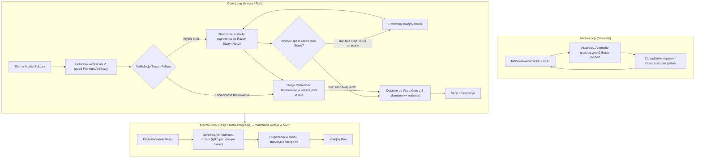

# GAMEPLAY.MD - AD ASTRA GAME DESIGN & CORE LOOP

## 1. HIGH CONCEPT & EXPERIENCE GOALS
**AdAstra** to kosmiczny survival-eksplorator w formule roguelike (krótkie runy trwające kilka minut). Gracz wciela się w pilota statku badawczo-ewakuacyjnego uciekającego z zapadającego się sektora przestrzeni kosmicznej przed **Frontem Anihilacji** (falą niszczycielskiej energii).

Gra łączy precyzyjny pilotaż arcade/6DoF z napięciem wynikającym z zarządzania zasobami (paliwo, kadłub, Rdzenie Stazy) oraz presją nieubłaganie nadciągającej ściany zagłady.

**Spoiwo runu:** w strefach zagrożeń powstają **Rdzenie Stazy** – kapsuły skrystalizowanej energii fali. Rdzeń jest jednocześnie **kluczem** (brama wymaga 2 rdzeni do skoku), **ratunkiem** (można go spalić, by na chwilę zatrzymać Front Anihilacji) i **inwestycją** (nadmiar dowieziony przez bramę idzie na ulepszenia między runami). Gracz musi wejść w strefy zagrożeń, ale sam wybiera, które – a w każdym kryzysie staje przed dylematem: spalić rdzeń i przeżyć teraz, czy zachować go jako klucz albo ulepszenie.

Długość runu wynika z układu sektora (sekcja 2.5) i nie ma sztywnego celu – run zostawia czas na eksplorację i interakcje z lokacjami, a presję trzyma fala.

**Fikcja i kierunek:** docelowo gracz zmierza do centrum galaktyki, a każdy skok przez Warp Gate to kolejny krok w jego stronę. W MVP run to jeden sektor; centrum galaktyki istnieje tylko w fikcji i w kierunku pętli makro (2.3).

> Dokument opisuje aktualne założenia projektowe. Reguły i liczby są hipotezami weryfikowanymi w playtestach i mogą się zmieniać w trakcie prac.

### 1.1. Cel projektowy (Design Target)
Cel MVP: run, który daje frajdę – dobry game feel i czytelne decyzje są ważniejsze niż kompletność opisu. Filary to kompas, nie lista wymagań: nowa mechanika lub lokacja powinna służyć co najmniej jednemu z nich.

**Filary:**
1. **Ucieczka na budżecie** – każde zboczenie z trasy gracz kupuje dystansem do fali. To pętla runu.
2. **Lot sam w sobie daje frajdę** – prędkość, manewry 6DoF i czytelna informacja zwrotna. To momenty.
3. **Ryzyko z wyboru, czasem w ciemno** – część lokacji pokazuje nagrodę z daleka (strefa z rdzeniem), część nie (lokacja nieznana, 4.8). To decyzje.

**Wspólna waluta – dystans do fali.** Front Anihilacji przesuwa się wzdłuż osi Z, więc czas spędzony poza postępem na Z (zboczenie, postój, objazd) zmniejsza dystans do fali. Pozostałe zasoby są jego formami:
* **Paliwo** – jak daleko dolecisz (budżet ruchu).
* **Kadłub** – ile błędów możesz popełnić (budżet pomyłek).
* **Rdzenie Stazy** – klucz do bramy, kupiony czas (Staza) i waluta ulepszeń między runami (2.3).

**Kontrakt lokacji:** każda lokacja i każdy moduł odpowiada na trzy pytania – ile kosztuje w dystansie, co oddaje i któremu filarowi służy. To pytania pomocnicze, nie bramka – odpowiedź może być przybliżona i wyjść dopiero z playtestu. Nowy zasób lub waluta ma sens wtedy, gdy ma ujście w pętli.

**Decyzje gracza w runie:** którą strefę pominąć, jak długo tankować, kiedy spalić rdzeń, ile nadmiaru rdzeni dowieźć do bramy i czy zboczyć do modułu samodzielnego.

**Kierunek długoterminowy (poza wycinkiem):** regrywalność przez losowy układ lokacji i lokacje nieznane. Sektor układa się tak, żeby to nie wymagało przebudowy (2.5), ale do czasu domknięcia wycinka nie powstaje kod na zapas.

---

## 2. TRÓJPOZIOMOWY GAMEPLAY LOOP

### 2.1. Pętla Mikro (Sekundy)
* Pilotaż statkiem w przestrzeni 3D oparty na fizyce.
* Czasowniki gracza w MVP: **steruj, boostuj, hamuj/dokuj, zbieraj, tnij (laser), aktywuj Stazę, wpisuj**. Walka i wrogie AI nie wchodzą do MVP; nowe systemy są dopuszczalne, jeśli wyraźnie spajają istniejące mechaniki.
* Każda strefa zagrożeń testuje inną umiejętność (4.5): precyzję przy prędkości (pole asteroid), czytanie zapowiedzi i timing (burza jonowa), zarządzanie pędem (anomalia grawitacyjna).
* Balansowanie użyciem boostu: ok. 2× szybszy lot za ok. 2,5× większe spalanie paliwa (zwykły lot = 1×) – boost jest droższy na metr, więc to wydatek na ucieczkę, a nie domyślny sposób lotu.
* **Między lokacjami głównymi:** przerwy to krótkie okna decyzji. Treść dają im **moduły samodzielne** (4.8), np. **wrak** (4.6) – zboczyć i rozciąć laserem skrzynie z ładunkiem kosztem czasu wobec fali, czy lecieć dalej. Rozmieszczenie wynika z zasad z 2.5.

### 2.2. Pętla Rdzenna (Minuty / Pojedynczy Run)
1. **Start:** Wylot ze stacji bazowej w kierunku bramy skokowej (Warp Gate) w autorskim sektorze. Gracz startuje z pełnym bakiem i nieuszkodzonym kadłubem.
2. **Nawigacja i Presja Czasu:** Warp Gate jest widoczna z daleka dzięki świecącemu beaconowi. HUD pokazuje paliwo, kadłub, dystans do bramy, dystans do Frontu Anihilacji oraz znacznik stacji pośredniej. Za plecami gracza przesuwa się ze stałą prędkością **Front Anihilacji**.
3. **Wymuszony Postój:** Pełny bak nie wystarcza na przelot całego sektora – bez tankowania na stacji pośredniej nie da się dolecieć do bramy.
4. **Zarządzanie Ryzykiem:**
   - **Stacja Pośrednia:** Gracz musi zatrzymać się w wiązce stacji i utrzymać w niej statek (4.2). Sam decyduje, kiedy odlecieć – pełny bak kosztem zbliżającej się fali albo wcześniejszy odlot z niepełnym bakiem.
   - **Strefy Zagrożenia:** Brama wymaga 2 **Rdzeni Stazy** (4.3), a w sektorze jest ich więcej. Nadmiar gracz wykorzystuje w trakcie runu (Staza) albo dowozi przez bramę i po udanym skoku wydaje na ulepszenia między runami (2.3) – to daje powód do kolejnego runu. W wycinku po jednym rdzeniu w polu asteroid, Strumieniu Asteroid (4.7) i burzy jonowej. Gracz musi zboczyć z trasy, ale wybiera, którą strefę pominąć. Anomalia grawitacyjna w wycinku nie ma rdzenia; docelowo nagradza samo ryzyko wyrzutem (4.5).
   - **Staza – klucz czy ratunek:** Każdy rdzeń można spalić, by zatrzymać falę – żeby dłużej tankować albo ratować się po błędzie. Spalony rdzeń przestaje być kluczem, więc trzeba zdobyć kolejny. Każdy rdzeń ponad wymagane 2 to zapas: można go spalić bez utraty klucza, ale wtedy przepada jako ulepszenie.
5. **Ekstrakcja:** Wlot do bramy Warp Gate rozpoczyna procedurę skoku (przechwycenie statku i autoryzacja w terminalu, patrz 4.4). Poprawna autoryzacja kończy run sukcesem.

**Reguła strojenia:** wprawny gracz jest w stanie zebrać wszystkie rdzenie w sektorze i dotrzeć do bramy z nadmiarem, ale z falą tuż za plecami. Średni gracz zbiera wymagane 2, może jeden zapas, i musi wybierać, które strefy pominąć. Na tej regule opiera się strojenie paliwa, dystansów i prędkości fali.

**Cel runu na HUD:** od pierwszej sekundy gracz widzi cel „Rdzenie 0/2 – dotrzyj do bramy”. Przy pierwszym rdzeniu pojawia się jednorazowa podpowiedź, jak aktywować Stazę (minimalny onboarding).

**Brak kluczy:** brama bez wymaganej liczby rdzeni się nie otwiera i nie przechwytuje statku. HUD z wyprzedzeniem ostrzega „brakuje rdzeni”, zanim gracz minie ostatnią strefę. Powrót po rdzeń oznacza lot w stronę fali, więc w praktyce brak kluczy kończy się porażką – dlatego spalenie rdzenia-klucza jest chronione zabezpieczeniem z 4.3.

### 2.3. Pętla Makro (Meta-Progresja i Persystencja)
**Minimalna wersja w MVP:**
* **Bankowanie:** rdzenie ponad wymagane, dowiezione przez bramę, trafiają do banku dopiero po udanym skoku. Porażka zabiera cały nadmiar z runu – końcówka runu stawia pytanie, ile jeszcze zaryzykować.
* **Menu ulepszeń** między runami: gracz wydaje zbankowane rdzenie na ulepszenia statku. Przykłady: wytrzymalszy kadłub, większy bak, dłuższa Staza, lepszy laser albo nowe narzędzie (np. skaner ujawniający lokacje nieznane, 4.8).
* **Umiar:** ulepszenia są małe albo poboczne (nowe narzędzia zamiast dużych bonusów), żeby po kilku runach nie znosiły presji fali. Wartości siedzą w ScriptableObjectach.
* **Nowe narzędzia (kandydaci – JESZCZE NIE ISTNIEJĄ):** proste w implementacji systemy, które dokładają czasownik albo nowy wybór, zamiast podbijać liczby. Każdy spełnia kontrakt lokacji (1.1) – ma koszt i nie znosi presji fali:
  - **Unik (evasive boost)** – krótki impuls w bok kosztem przegrzania lub chwilowego wyłączenia silnika.
  - **SOS** – gdy skończy się paliwo, sygnał coś aktywuje (np. zrzut ratunkowy kosztem czasu albo z ryzykiem); rozwija pomysł z taska „Distress beacon (SOS)”.
  - **Laser górniczy** – ulepszony laser kopie asteroidy. Zmienia regułę z 4.6 („laser nie rani asteroid”) tylko dla tego ulepszenia; urobek wymaga ujścia w pętli (np. paliwo lub kadłub, w limitach z 2.5).
  - **Skaner** – ujawnia zawartość lokacji nieznanych (4.8).
* **Persystencja – DO GRILLA:** bank i kupione ulepszenia mają się zapisywać lokalnie między uruchomieniami gry. Format, miejsce zapisu i to, kto go posiada (bez nowego globalnego singletona bez zgody), rozstrzyga osobny grill przed realizacją.

**Poza MVP:** predefiniowane warianty statku (np. Lekki Zwiadowca, Ciężki Frachtowiec), ranga pilotażu, proceduralny generator sektora zamiast autorskiego sektora po ustabilizowaniu pętli rdzennej.

### 2.4. Zakres MVP
MVP to pętla rdzenna (2.2) zbudowana na mechanikach z sekcji 4, strefach zagrożeń z Rdzeniami Stazy i Froncie Anihilacji, plus minimalna pętla makro (2.3): bankowanie nadmiaru rdzeni i ulepszenia między runami.

**Kolejność realizacji – pionowy wycinek:** najpierw jeden kompletny run z celem i dylematem, złożony z tego, co już istnieje: pole asteroid z gęstym środkiem, Strumień Asteroid i obecna burza jonowa (bez przebudowy) – każde z rdzeniem; anomalia bez rdzenia; stacja z obecnym tankowaniem; wrak i drobne moduły samodzielne w tranzycie (4.8). Wymagana liczba rdzeni jest parametrem konfiguracji (ScriptableObject). Kolejne kroki:
1. **Integracja sektora** – przebudowa układu świata z istniejących lokacji: run da się przejść od startu do bramy, z wyborem stref (2.5).
2. **Playtest wycinka** z notatkami (`Assets/DOCS/raports/playtests/`), m.in.: czy cel jest jasny, czy gracz wchodzi w strefy, czy „spalić czy zachować rdzeń” to prawdziwy dylemat, gdzie run jest nudny i która lokacja jest najuboższa.
3. **Poprawki według notatek** – rozbudowa lokacji, flight feel pass, HUD, ewentualnie minigra tankowania oraz przebudowy burzy jonowej i anomalii.
4. **Minimalna meta-progresja (2.3)** – bankowanie i menu ulepszeń; kolejny playtest sprawdza, czy nadmiar rdzeni tworzy dylemat „spalić czy dowieźć”.

Zakres nie jest zamknięty. Nowe mechaniki i lokacje (minigry, nowe zagrożenia – w tym wrogie AI i walka, alternatywne trasy) są mile widziane, ale wchodzą dopiero wtedy, gdy pętla „start → stacja → brama” jest grywalna i przetestowana. Pomysły czekają jako taski w kolumnie *Ideas* na boardzie projektu.

### 2.5. Układ Sektora (Blockout)
Sektor to jedna linia krytyczna wzdłuż osi Z ze swobodą manewru na boki, od startu (Hub) do Warp Gate. Fala przesuwa się wzdłuż Z, więc oś Z to czas: kolejność elementów na Z wyznacza rytm napięcia.

**Elementy sektora:**
* **Lokacje główne (beaty)** – duże, wyraziste lokacje z własną mechaniką lub łamigłówką, projektowane indywidualnie: pole asteroid z gęstym środkiem, burza jonowa, anomalia grawitacyjna (czarna dziura, do przebudowy). Zwykle trzymają Rdzenie Stazy.
* **Moduły** (4.8) – mniejsze, samodzielne elementy: **usługowe** (stacja pośrednia, 4.2 – obowiązkowa) i **opcjonalne** (wrak, skrzynie, rzadkie pole, Strumień Asteroid jako moduł-zagrożenie, przyszłe eventy).
* **Start i Warp Gate** to punkty końcowe, nie beaty.

**Zasady rozmieszczenia** (zamiast stałej tabeli beatów – układ wynika z zasad game designu i playtestu):
1. **Stacja w zasięgu paliwa:** da się do niej dolecieć z pełnego baku, a po zatankowaniu – dolecieć do bramy. Sprawdza się przelotem, nie obliczeniem.
2. **Brama osiągalna:** run z wymaganymi rdzeniami kończy się przed falą z czasem na terminal. Też sprawdza się przelotem.
3. **Napięcie rośnie ku bramie:** najprostsza lokacja główna leży wcześnie (uczy), najtrudniejsza bliżej końca.
4. **Lokacje główne się nie zlewają**, chyba że celowo – każda ma swoje „wejście na scenę”.
5. **Moduły opcjonalne** stoją w przerwach, przy lokacjach głównych, a nawet w ich wnętrzu – tam, gdzie spełniają kontrakt lokacji (1.1). Przerwa między lokacjami to seam: można w niej postawić istniejące moduły lub lokacje albo nowe elementy, gdy powstaną.
6. **Z każdego miejsca trasy widać co najmniej jedną rzecz, do której warto skręcić.**
7. Pozostałe odległości i liczby ustawia się orientacyjnie, „na oko” – playtest koryguje, balans przychodzi na końcu.

**Szerokość na boki:** lokacje wychodzą na boki (także nad i pod trasę). W wycinku rozszerza się je tylko istniejącymi parametrami (promień, rozmiar, pozycja); nowa treść lokacji przychodzi po playteście.
* Każdą lokację da się ominąć – nawet taką, która przecina trasę. Objazd to zwykły koszt w dystansie.
* Boki nie mają granicy: lot w bok nie przybliża do bramy, a fala idzie dalej, więc karze go sama.
* **Sloty:** każda lokacja i moduł to samodzielny prefab bez referencji do innych lokacji. Późniejsze losowanie układu ma być wyborem prefabu i pozycji według zasad rozmieszczenia, a nie przebudową sektora.

**Metoda:**
1. **Przybliżone wartości.** Liczby (prędkości, naprawy, czas tankowania) to szacunki do późniejszego balansu; twarde są tylko zasady 1–2.
2. **Element = podmienialny segment.** Nowa mechanika to podmiana lub dołożenie lokacji albo modułu, a nie przebudowa sektora. Sektora nie buduje się pod mechaniki, których jeszcze nie ma – bez pustych placeholderów i rezerwowania przestrzeni „na zapas”.
3. **Blockout → playtest → strojenie liczb → dopiero dekoracja.**

Poprzednia tabela beatów i odcinków tranzytowych jest zarchiwizowana w `Assets/DOCS/raports/design_decisions.md`.

**Reguły strojenia modułów:**
* Paliwo z modułów to dodatek – stacja zostaje główną i w praktyce konieczną dostawą paliwa (2.2.3). To szacunek do sprawdzenia w playteście, nie twardy limit: gracz zwykle nie zbiera wszystkiego, bo każda skrzynia kosztuje czas.
* Salvage (wraki i samotne skrzynie) to dodatek, nie konkurencja dla klucza – orientacyjnie cały salvage w sektorze nie powinien wyraźnie przebijać naprawy z Rdzeni Stazy. To szacunek do sprawdzenia w playteście, nie twardy limit.

**Dystans do fali jako miara:** postój lub lot poza postępem na Z kosztuje tyle, ile fala przejdzie w tym czasie, a Staza ten dystans oddaje. To sposób myślenia o kosztach, nie budżet do wyliczania – liczby ustala playtest.

Mechaniki i lokacje na tym etapie powstają z prymitywów; docelowe assety przychodzą po strojeniu (krok 4 metody).

---

## 3. WARUNKI ZWYCIĘSTWA I PORAŻKI

### 3.1. Zwycięstwo (Run Complete)
* Wlot statkiem w bramę **Warp Gate** i ukończenie procedury skoku (4.4), zanim kadłub zostanie zniszczony.
* Ekran podsumowania (MVP): czas ucieczki (od startu do poprawnej autoryzacji), pozostały kadłub %, pozostałe paliwo %, najmniejszy dystans do Frontu Anihilacji w trakcie runu, Rdzenie Stazy zebrane / użyte / zbankowane, przycisk Restart oraz przejście do menu ulepszeń (2.3).
* Docelowo podsumowanie rozszerzy się o rangę pilotażu.

### 3.2. Porażka (Game Over)
* **Destrukcja Kadłuba:** Zderzenia z asteroidami przy dużej prędkości, uderzenia piorunów w burzy jonowej, wplucie z jądra anomalii lub obrażenia od Frontu Anihilacji.
* **Pochłonięcie przez Front Anihilacji:** Wpadnięcie w strefę niszczącej energii (gwałtowne obrażenia redukujące kadłub do zera).
* **Wytracenie Ciągu (Brak Paliwa - Stan Dead-Stick):**
  - Gdy paliwo się kończy, silniki główne oraz silniki manewrowe gasną. Gracz traci kontrolę nad lotem i rotacją, a statek **dryfuje** na resztce pędu w ostatnim kierunku lotu: opór spada prawie do zera, więc statek leci jeszcze daleko (z boosta dalej), ale skończenie – w końcu staje.
  - Z silnikami opór jest wyraźny: ogranicza prędkość maksymalną, a po puszczeniu ciągu statek hamuje. Dzięki temu nie da się „pyknąć” ciągu i lecieć za darmo – dryf jest tylko ostatnim ratunkiem.
  - Sam brak paliwa **nie wywołuje natychmiastowego Game Over** – porażka następuje, gdy unieruchomiony statek dogoni Front Anihilacji. Ratunkiem jest dryf do strefy stacji pośredniej lub bramy Warp Gate: ostatnie paliwo można spalić na boost i „wystrzelić się” w ich stronę, celując przed wygaśnięciem silników.
  - Paliwo działa więc jak budżet dystansu: lot je zużywa, postój nie.

### 3.3. Koniec Runu
* Wygrana i porażka kończą run w ten sam sposób: sterowanie zostaje zablokowane, pojawia się panel końca runu, a przycisk Restart rozpoczyna run od nowa.

---

## 4. GŁÓWNE MECHANIKI DYNAMIZUJĄCE

### 4.1. Front Anihilacji (The Annihilation Wave)
Liniowa ściana energii przesuwająca się ze stałą prędkością wzdłuż osi ucieczki sektora (oś Z):
1. **Strefa Ostrzegawcza (przed frontem):**
   - Narastające ostrzeżenia wizualne (docelowo także dźwiękowe) w miarę zbliżania się fali.
   - Wskaźnik w HUD pokazujący dystans do fali.
2. **Front Niszczący:**
   - Zadaje gwałtowne obrażenia kadłubowi co sekundę.
   - Pozwala na dramatyczną ucieczkę "w ostatniej chwili", jeśli gracz posiada resztki paliwa na boost.
3. **Staza:** Spalenie Rdzenia Stazy (4.3) zatrzymuje front na ~25 s – mniej więcej tyle, ile kosztuje jedno zboczenie po rdzeń. Fala zamiera, jej kolor przechodzi w chłodny, dźwięk cichnie, a HUD pokazuje odliczanie nad wskaźnikiem dystansu do fali.

### 4.2. Stacja Pośrednia (Tankowanie na Postoju)
* **Moduł usługowy:** stacja nie jest lokacją główną, tylko obowiązkowym modułem (4.8). W MVP sektor ma jedną stację, położoną na linii krytycznej tam, gdzie wynika to z budżetu paliwa (2.5, zasada 1). HUD wskazuje jej położenie.
* Paliwo napływa stopniowo tylko wtedy, gdy statek praktycznie stoi wewnątrz strefy stacji.
* Statek bez paliwa, który wdryfuje w strefę stacji, zostaje przez nią wyhamowany i może zatankować. Statek z paliwem przelatuje przez strefę bez hamowania i dokuje sam.
* **Minigra „wiązka” (hipoteza do weryfikacji w playteście):** stacja trzyma statek wiązką, a przepływ paliwa zależy od tego, jak blisko środka wiązki gracz utrzymuje statek. Turbulencje od nadciągającej fali spychają statek coraz mocniej, więc gracz koryguje pozycję zwykłym sterowaniem. Tankowanie robi się trudniejsze właśnie wtedy, gdy decyzja „odlecieć teraz czy jeszcze chwilę” jest najostrzejsza.
* **Presja na postoju:** kamera lekko drży, a HUD miga ostrzeżeniem „fala za X s”, nasilającym się w miarę zbliżania frontu.
* Gracz może odlecieć w każdej chwili – czas spędzony na tankowaniu to czas, w którym zbliża się Front Anihilacji (chyba że spali Rdzeń Stazy).
* Podział ról: stacja uzupełnia paliwo, kadłub częściowo naprawiają Rdzenie Stazy (4.3).
* Hub startowy jest tylko punktem startu i nie pełni roli stacji.

### 4.3. Rdzenie Stazy (Stasis Cores)
* **Fikcja:** zagrożenia w sektorze to odpryski tej samej energii, która tworzy Front Anihilacji. W ich wnętrzu energia krystalizuje się w Rdzenie Stazy, które statek potrafi wykorzystać przeciwko fali.
* **Rozmieszczenie:** rdzenie leżą przeważnie w miejscach o dużym zagrożeniu – w lokacjach głównych (4.5) i modułach-zagrożeniach (4.7), w ich najniebezpieczniejszej części, poza linią krytyczną – zebranie rdzenia kosztuje zboczenie. W wycinku: pole asteroid, Strumień Asteroid i burza jonowa; anomalia grawitacyjna dostaje rdzeń razem ze swoją przebudową. Rdzeń świeci pulsującym, zimnym biało-cyjanowym światłem, a pionowy snop światła (ok. 150 m) wyróżnia go z daleka nawet na tle świecących stref.
* **Potrójna rola:** rdzeń jest **kluczem** do bramy (wymagane 2, patrz 4.4), **ratunkiem** – można go spalić jako Stazę – i **inwestycją**: nadmiar dowieziony przez bramę idzie na ulepszenia (2.3). Spalony rdzeń przestaje być kluczem i ulepszeniem.
* **Zebranie:** dodaje 1 rdzeń do licznika oraz natychmiast naprawia 20% kadłuba – wejście w strefę częściowo „zwraca” obrażenia w niej odniesione.
* **Licznik:** gracz zaczyna run z 0 i nie ma limitu noszenia. HUD pokazuje cel „Rdzenie X/2”. Wymagana liczba (domyślnie 2) jest parametrem konfiguracji.
* **Staza:** jeden klawisz (akcja w `playerInput.inputactions`) spala rdzeń, działa w locie, na stacji i w terminalu bramy. Efekt: Front Anihilacji zatrzymuje się na ~25 s (4.1).
* **Zabezpieczenie:** spalenie rdzenia, który jest potrzebny jako klucz (licznik ≤ 2), wymaga przytrzymania klawisza, a HUD ostrzega, że gracz traci klucz. Zapasowy rdzeń spala się zwykłym wciśnięciem.
* **Prowadzenie (stan roboczy, do doprecyzowania osobnym grillem):** strefy zagrożeń są zawsze oznaczone w HUD (ikona i dystans); rdzeń dostaje własny znacznik dopiero w zasięgu wykrycia (~250 m).
* **Przeważnie z zagrożeń:** rdzenie krystalizują się wewnątrz zagrożeń, więc domyślnie każdy rdzeń kosztuje wejście w niebezpieczne miejsce – rdzeń łatwo dostępny byłby darmową Stazą albo darmowym ulepszeniem. Inne źródło jest dopuszczalne, jeśli uzasadnia je game design (np. nagroda z losowego eventu, 4.8). Więcej rdzeni w sektorze oznacza zwykle więcej zagrożeń albo kolejny rdzeń głębiej w tym samym.
* **Dylemat stoi na koszcie alternatywnym:** każdy rdzeń to klucz, ratunek albo ulepszenie – nigdy wszystko naraz. Nawet gdy klucze są pewne, każda Staza kosztuje ulepszenie.
* **Liczba rdzeni w sektorze** jest parametrem układu, dopasowywanym do potrzeb (klucze, Staza, meta-progresja) – może być ich więcej niż wymaga brama. Rdzeń może leżeć w każdej strefie zagrożeń, także w Strumieniu Asteroid (4.7). Ryzyko do sprawdzenia w playteście: przy zbyt wielu łatwych rdzeniach klucz przestaje być problemem – nadmiar musi wymagać głębszego wejścia w strefy.

### 4.4. Warp Gate (Cel Runu i Procedura Skoku)
Brama skokowa na końcu korytarza sektora. Finał runu łączy pilotaż z krótką minigrą pod presją Frontu Anihilacji.

**Dotarcie:** Brama jest punktem orientacyjnym widocznym z daleka (świecący beacon), a HUD pokazuje dystans do niej oraz liczbę zebranych kluczy (Rdzenie X/2). Napięcie końcówki wynika z układu sektora – po tankowaniu gracz ściga się z falą o resztki paliwa, mając cel przed sobą. Brama nie wprowadza dodatkowych mechanik utrudniających podejście.

**Procedura skoku:**
1. **Przechwycenie:** Wlot w strefę bramy z co najmniej 2 Rdzeniami Stazy blokuje sterowanie statkiem, a brama pobiera 2 rdzenie jako klucz. Brama płynnie dociąga statek do punktu dokowania w swoim centrum i wygasza jego prędkość. Procedury nie można przerwać ani opuścić bramy. Bez wymaganych rdzeni brama się nie otwiera (2.2). **Do rozstrzygnięcia (#74):** czy brama twardo wymaga rdzeni, czy brak rdzenia wydłuża run (np. dłuższe ładowanie bramy lub dodatkowe działania pod presją fali).
2. **Autoryzacja w terminalu:** Na ekranie pojawia się terminal z krótkim słowem wylosowanym z puli tematycznych słów. Długość słowa jest stała – presję tworzy fala, a jedyną ulgą jest zapasowy rdzeń (ponad wymagane), który gracz może spalić jako Stazę w trakcie procedury – kosztem ulepszenia. Gracz musi wpisać je z klawiatury; wielkość liter nie ma znaczenia.
   - Poprawne litery są wyraźnie potwierdzane.
   - Błędny znak jest odrzucany z czytelnym sygnałem błędu, a dotychczasowy postęp zostaje zachowany. Karą za pomyłkę jest stracony czas.
3. **Presja fali:** Przez cały czas trwania procedury Front Anihilacji porusza się dalej i zadaje obrażenia. Jeśli dogoni unieruchomiony statek i zniszczy kadłub przed ukończeniem autoryzacji, run kończy się porażką.
4. **Skok:** Poprawne wpisanie słowa zatrzymuje licznik czasu i Front Anihilacji. Statek zostaje wciągnięty w bramę z narastającą prędkością, kamera rozszerza pole widzenia (efekt warp), a obraz rozjaśnia się do bieli.
5. **Podsumowanie:** Po skoku wyświetla się ekran podsumowania runu (3.1).

### 4.5. Strefy Zagrożeń
Każda strefa leży obok linii krytycznej, ma w środku Rdzeń Stazy i testuje inną umiejętność. Dzięki temu strefy są wyborem gracza, a nie trzema wersjami „omijaj”.

| Strefa | Umiejętność | Dlaczego gracz wchodzi | Koszt |
|--------|-------------|------------------------|-------|
| Pole asteroid | Precyzja przy prędkości | Rdzeń w gęstym środku | Zderzenia, czas na wolny przelot |
| Burza jonowa | Czytanie zapowiedzi, timing | Rdzeń w centrum burzy | Trafienia piorunów, zakłócenia |
| Anomalia grawitacyjna | Zarządzanie pędem | Rdzeń na orbicie + wyrzut (darmowy dystans) | Paliwo na wyjście, ryzyko wplucia |

**Pole asteroid:** gęstość rośnie w stronę środka – krawędź jest rzadka i bezpieczna, środek wymaga ciasnych przelotów. Wolny lot jest bezpieczny, ale fala goni.
* **Układ:** spłaszczone pole ze skupiskami wokół wielkich głazów (punkty orientacyjne) i drobnicą między nimi; im bliżej środka, tym gęściej. Rdzeń leży w małej, pustej kieszeni, do której prowadzi jedno wejście od strony nadlatującego gracza – przez nie widać światło rdzenia.
* **Oddychanie:** asteroidy krążą wokół swoich miejsc (bliżej rdzenia mocniej) i pulsują w rytm rdzenia, więc prześwity otwierają się i zamykają. Trącona asteroida wraca na miejsce – pole żyje, ale się nie rozpada.
* **Zapadnięcie:** po zabraniu rdzenia pole przez kilkanaście sekund zaciska się ku środkowi – zebranie klucza kończy się ucieczką z pola.
* **Rzadkie pole dryfujące:** osobna lokacja bez rdzenia – luźne, dryfujące asteroidy do swobodnego rozstawiania jako tło i drobna przeszkoda.

**Burza jonowa:** uderzenie celuje tam, gdzie statek *będzie* za ~1 s (przewidywanie z wektora prędkości). Przez tę sekundę widać świecący znacznik i słychać narastający ładunek. Unik wymaga zmiany kursu lub prędkości; lot prosto ze stałą prędkością kończy się trafieniem. W centrum burzy uderzenia są częstsze. Trafienie zabiera kadłub i na chwilę zakłóca HUD/sterowanie.

**Anomalia grawitacyjna:**
* Przyciąganie jest czysto radialne (bez wirów i tłumienia) i stałe w obrębie pierścienia. Wewnątrz całej strefy statek traci opór silników (opór jak przy pustym baku) – anomalia zakrzywia przestrzeń, więc pęd zależy wyłącznie od gracza. Pierścienie mówią, gdzie da się **zatrzymać**:
  - **krawędź:** ok. 6 m/s², zwykły ciąg (12) wystarcza, żeby się zatrzymać i wycofać;
  - **pierścień wewnętrzny:** ok. 18 m/s², bez boostu (24) nie da się zatrzymać ani wspiąć – ucieka się pędem albo boostem;
  - **jądro:** punkt bez powrotu.
* Anomalia przyciąga każde dynamiczne ciało w strefie, nie tylko statek.
* Rdzeń Stazy krąży po orbicie w środku pierścienia wewnętrznego, w płaszczyźnie dysku akrecyjnego, wolniej niż statek (ok. minuty na okrążenie).
* **Proca (wyrzut):** nagrodą jest przelot, a nie granica pierścienia. Statek, który wleci po stycznej, rozpędza się, spadając ku jądru, zakręca wokół niego i wylatuje. Boost odpalony w najniższym punkcie przelotu daje więcej prędkości niż ten sam boost w pustej przestrzeni (efekt Obertha) – to jedyny „darmowy” dystans w grze i wynika z umiejętności. Po wylocie ze strefy statek ma jeszcze ok. 3 s niskiego oporu, żeby zdobyta prędkość zamieniła się w dystans; kamera kopie proporcjonalnie do prędkości wylotu.
* **Sterowność:** w strefie i w oknie procy trzymanie ciągu do przodu obraca kierunek lotu w stronę nosa statku (ok. 60°/s) bez utraty prędkości – bez tej asysty statek przy dużej prędkości „wyślizguje się”. Bez ciągu tor wynika z czystej fizyki orbity. Powyżej ok. 110 m/s strefa dodaje opór, żeby krążenie z ciągiem nie rozpędzało statku bez końca.
* **Przewidywany tor:** w strefie widać hologramową, przerywaną linię toru na najbliższe ok. 4,5 s lotu bez ciągu. Pokazuje skutek (zakręt wokół jądra, otarcie, wylot), a nie trasę do przelotu – linię procy gracz znajduje sam.
* **Sygnał głębokości:** w pierścieniu wewnętrznym kamera lekko wibruje, a krawędzie ekranu ciemnieją – im bliżej jądra, tym mocniej.
* **Wplucie:** każde ciało, które wpadnie w jądro, zostaje wystrzelone do tyłu, w stronę Frontu Anihilacji, pod losowym kątem (stożek ok. 30° wokół osi sektora), a anomalia ignoruje je, dopóki nie opuści strefy. Statek traci przy tym 30% kadłuba. Run trwa dalej, ale gracz traci dystans i czas.
* **Wygląd:** czarne jądro z jasnym obrysem, obracający się dysk akrecyjny (jasny i gęsty w pierścieniu wewnętrznym, rzadki na krawędzi) i pył spływający ku jądru, który pokazuje kierunek przyciągania.
* Poprzednia wersja (najsilniejsze przyciąganie przy krawędzi, pułapka bez wyjścia) jest zachowana jako `BlackHoleDeathTrap` poza sektorem. Przed ponownym użyciem potrzebuje własnej roli i wyglądu, który z daleka zdradza, że to pułapka.

### 4.6. Wraki
Wrak to krótki, aktywny moment zręcznościowy w tranzycie. Gracz decyduje, czy zboczyć kosztem czasu wobec fali, i zamienia celowanie w ruchu na zasób. Opis dotyczy proof of conceptu; liczby są hipotezami w ScriptableObject.
* **Układ:** jeden nieruchomy wrak z migającym światłem (beacon) widocznym z daleka. Wokół niego 4 skrzynie z ładunkiem powoli krążą po różnych orbitach, co najmniej jedna blisko kadłuba – najlepsze sztuki wymagają ciasnego lotu. Fikcja: kontenery wyrzucone z rozbitego statku.
* **Laser-multitool:** nowy czasownik „tnij” – trzymanie LPM (akcja w `playerInput.inputactions`). Laser jest zawsze dostępny, ale tnie wyłącznie skrzynie: nie rani asteroid ani innych obiektów i nie działa na nie fizycznie, więc nie jest bronią. Nie działa, gdy sterowanie jest zablokowane (brama, terminal, koniec runu, pauza); poza tym działa także bez paliwa i podczas Stazy.
* **Naprowadzanie:** niewidzialny, wąski prostopadłościan przed dziobem (~6 × 6 × 40 m). Skrzynia w jego wnętrzu przyciąga wiązkę, nawet jeśli nie leży na osi statku – kamera za statkiem nie wymaga idealnego celowania. Bez celu w strefie LPM rysuje krótką, słabą wiązkę prosto z dziobu, bez efektu.
* **Cięcie:** skrzynia musi być w strefie łącznie ~1,5 s; postęp zostaje, gdy wypadnie ze strefy. Przelot obok z wciśniętym LPM nie wystarcza – trzeba zwolnić i trzymać cel, a skrzynie się przesuwają. Postęp widać na skrzyni: rozgrzewa się od zimnego koloru do bieli, w punkcie styku sypią się iskry, narasta dźwięk. Bez paska na HUD.
* **Nagroda:** przecięta skrzynia pęka i od razu oddaje zasób, z błyskiem i wartością „+X” przy pasku. Kolor skrzyń oznacza typ zawartości: **kadłub** (~4%) albo **paliwo** (~10% baku). Wraki mają autorski miks typów, z przewagą paliwa. Zebranie części skrzyń to legalny kompromis.
* **Ryzyko:** wrak i skrzynie są przeszkodami z obrażeniami od zderzeń. Skrzynie są kinematyczne – po zderzeniu wracają na orbitę. Gracz ryzykuje kadłub, żeby zyskać kadłub.
* **Otwarte:** koszt lasera (przegrzanie, paliwo albo brak kosztu) – decyzja po playteście. Znacznik HUD wraku przyjdzie ze wspólnym systemem znaczników celów.
* **Na później:** losowanie pozycji wraku i typu skrzyń (paliwo podlega szacunkowi „moduły nie zastępują stacji”, 2.5). W wersji roguelite skrzynie mają dawać ulepszenia statku zamiast zasobów zastępczych.
* **Warianty:** warianty prefabu wraku – mały wrak (`SalvageWreck_Small`, 2 skrzynie) i pole szczątków bez kadłuba (`SalvageDebris`, 2 skrzynie), a pojedyncza skrzynia działa także samodzielnie, bez wraku – stoi w miejscu i daje się ciąć (4.8).

---

### 4.7. Strumień Asteroid
Płaska „rzeka” asteroid w poprzek trasy – przeszkoda w tranzycie, która testuje odczytanie ruchu przy prędkości. Gracz przecina ją w kilka sekund albo obchodzi kosztem czasu.
* **Ruch:** losowa asteroida w losowym momencie dostaje impuls, głównie w poprzek trasy (tam i z powrotem). Między impulsami zwalnia, a po wyjściu poza obszar strumienia zawraca łukiem – strumień zostaje na miejscu, ale nie ma stałego wzorca.
* **Zapowiedź:** asteroida rozbłyska na ~0,7 s przed impulsem, więc trafienie jest ryzykiem do odczytania, a nie loterią.
* **Nagroda:** czysty hazard. Może trzymać Rdzeń Stazy w środku (4.3) – wtedy staje się strefą zagrożeń z wyboru.
* **Staza** nie zamraża strumienia – to nie energia fali.

### 4.8. Moduły Samodzielne
Moduł samodzielny to mniejszy element, który nie jest lokacją główną (2.5). Może stać w przerwach między lokacjami, przy nich albo w ich wnętrzu. Spełnia kontrakt lokacji (1.1) i jest samodzielnym prefabem (sloty, 2.5). Rodzaje:
* **Usługowy (obowiązkowy):** stacja pośrednia (4.2) – na linii krytycznej, pozycja z budżetu paliwa.
* **Opcjonalny:** kosztuje kilka sekund i oddaje niewiele albo nic (wtedy jest przeszkodą lub punktem orientacyjnym). Zwykle bez Rdzeni Stazy; wyjątkiem są moduły-zagrożenia (Strumień Asteroid, 4.7) i eventy, w których game design to uzasadnia (4.3).

**Istniejące (wchodzą do wycinka):**
* **Stacja pośrednia** (4.2) – moduł usługowy.
* **Strumień Asteroid** (4.7) – moduł-zagrożenie, może trzymać rdzeń.
* **Wrak** z krążącymi skrzyniami (4.6) i jego mniejszy wariant z 1–2 skrzyniami.
* **Samotna skrzynia** – pojedyncza skrzynia do cięcia laserem, bez wraku.
* **Rzadkie pole dryfujące** (4.5) – luźne asteroidy jako lekka przeszkoda i punkt orientacyjny, bez nagrody.

**Rekomendowane pomniejsze eventy – JESZCZE NIE ISTNIEJĄ.** Tabela to punkt wyjścia (seam w MVP), który można swobodnie zmienić lub rozwinąć. Każdy kandydat używa istniejących czasowników i płaci w dystansie; wybór, co powstaje najpierw, wynika z playtestu wycinka.

| Moduł | Czasownik | Koszt | Nagroda | Co można wykorzystać |
|-------|-----------|-------|---------|----------------------|
| Kapsuła ratunkowa | Hamuj/dokuj – stań przy kapsule na kilka sekund | Postój = dystans | Kadłub lub paliwo | Strefa postoju stacji |
| Uciekający kontener | Tnij w pościgu – skrzynia odlatuje od gracza | Czas i boost | Większa niż zwykła skrzynia | Skrzynia z wraku z własnym ruchem |
| Skrytka z kodem | Wpisuj – krótkie słowo przy boi, bez blokady sterowania | Zatrzymanie się | Paliwo lub kadłub | Terminal bramy i pula słów |
| Kieszeń w polu szczątków | Precyzyjny lot – skrzynia w środku małego, gęstego skupiska | Ryzyko zderzeń | Kadłub | Spawn asteroid i skrzynia |
| Sygnał nieznany | Podleć i sprawdź | Czas | Losowo: nagroda, pułapka albo wybór | Filar 3 „w ciemno” – lokacja nieznana |

## 5. ROZWÓJ POZA MVP
Pomysły spoza MVP (m.in. bezwładny model lotu z dryfem, alternatywne trasy, run złożony z wielu skoków w stronę centrum galaktyki, wrogie AI i walka, moduły statku zdobywane w strefach, ładowanie bramy rdzeniami, magnes dokujący, prądy jonowe w tranzycie, energia za lot blisko zagrożeń, materiały z wraków jako waluta, sygnał SOS, generator proceduralny, rozbudowana meta-progresja z wariantami statku) są prowadzone jako taski w kolumnie *Ideas* na boardzie projektu „AdAstra Kanban”. Dokument opisuje je zwykle dopiero wtedy, gdy wchodzą do realizacji; wyjątkiem są rekomendacje oznaczone jako jeszcze nieistniejące (np. 4.8), które wyznaczają kierunek.
