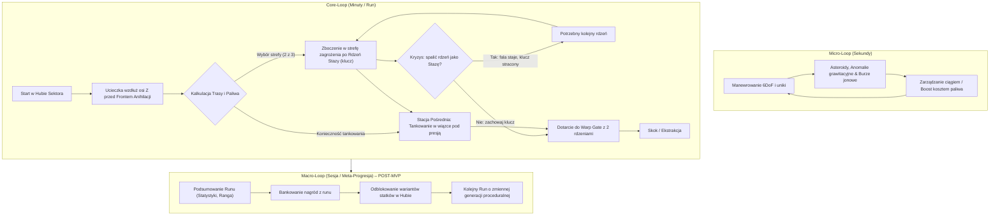

# GAMEPLAY.MD - AD ASTRA GAME DESIGN & CORE LOOP

## 1. HIGH CONCEPT & EXPERIENCE GOALS
**AdAstra** to kosmiczny survival-eksplorator w formule roguelike (krótkie runy trwające kilka minut). Gracz wciela się w pilota statku badawczo-ewakuacyjnego uciekającego z zapadającego się sektora przestrzeni kosmicznej przed **Frontem Anihilacji** (falą niszczycielskiej energii).

Gra łączy precyzyjny pilotaż arcade/6DoF z napięciem wynikającym z zarządzania zasobami (paliwo, kadłub, Rdzenie Stazy) oraz presją nieubłaganie nadciągającej ściany zagłady.

**Spoiwo runu:** w strefach zagrożeń powstają **Rdzenie Stazy** – kapsuły skrystalizowanej energii fali. Rdzeń jest jednocześnie **kluczem** (brama wymaga 2 rdzeni do skoku) i **ratunkiem** (można go spalić, by na chwilę zatrzymać Front Anihilacji). Gracz musi wejść w strefy zagrożeń, ale sam wybiera, które – a w każdym kryzysie staje przed dylematem: spalić rdzeń i przeżyć teraz, czy zachować klucz.

Długość runu nie jest celem samym w sobie – wynika z układu sektora (sekcja 2.5) i jest mierzona podczas blockoutu.

> Dokument opisuje aktualne założenia projektowe. Reguły i liczby są hipotezami weryfikowanymi w playtestach i mogą się zmieniać w trakcie prac.

---

## 2. TRÓJPOZIOMOWY GAMEPLAY LOOP

### 2.1. Pętla Mikro (Sekundy)
* Pilotaż statkiem w przestrzeni 3D oparty na fizyce.
* Czasowniki gracza w MVP: **steruj, boostuj, hamuj/dokuj, zbieraj, aktywuj Stazę, wpisuj**. Walka i wrogie AI nie wchodzą do MVP; nowe systemy są dopuszczalne, jeśli wyraźnie spajają istniejące mechaniki.
* Każda strefa zagrożeń testuje inną umiejętność (4.5): precyzję przy prędkości (pole asteroid), czytanie zapowiedzi i timing (burza jonowa), zarządzanie pędem (anomalia grawitacyjna).
* Balansowanie użyciem boostu (prędkość ucieczki vs ponad dwukrotnie szybsze spalanie paliwa).
* **Otwarty punkt (priorytet):** gracz potrzebuje czynności i interakcji także między lokacjami i wokół nich (rozmieszczonych losowo), żeby odcinki tranzytowe nie były samym lotem prosto. Kształt ustala osobny grill (kandydaci: zdobywanie materiałów i złomowanie wraków, dodatkowy Rdzeń Stazy w losowym miejscu, pickupy paliwa na trasie, energia za lot blisko zagrożeń).

### 2.2. Pętla Rdzenna (Minuty / Pojedynczy Run)
1. **Start:** Wylot ze stacji bazowej w kierunku bramy skokowej (Warp Gate) w autorskim sektorze. Gracz startuje z pełnym bakiem i nieuszkodzonym kadłubem.
2. **Nawigacja i Presja Czasu:** Warp Gate jest widoczna z daleka dzięki świecącemu beaconowi. HUD pokazuje paliwo, kadłub, dystans do bramy, dystans do Frontu Anihilacji oraz znacznik stacji pośredniej. Za plecami gracza przesuwa się ze stałą prędkością **Front Anihilacji**.
3. **Wymuszony Postój:** Pełny bak nie wystarcza na przelot całego sektora – bez tankowania na stacji pośredniej nie da się dolecieć do bramy.
4. **Zarządzanie Ryzykiem:**
   - **Stacja Pośrednia:** Gracz musi zatrzymać się w wiązce stacji i utrzymać w niej statek (4.2). Sam decyduje, kiedy odlecieć – pełny bak kosztem zbliżającej się fali albo wcześniejszy odlot z niepełnym bakiem.
   - **Strefy Zagrożenia:** Brama wymaga 2 **Rdzeni Stazy** (4.3), a w sektorze są 3 – po jednym w polu asteroid, burzy jonowej i anomalii grawitacyjnej. Gracz musi zboczyć z trasy, ale wybiera, którą strefę pominąć. Anomalia dodatkowo nagradza samo ryzyko wyrzutem (4.5).
   - **Staza – klucz czy ratunek:** Każdy rdzeń można spalić, by zatrzymać falę – żeby dłużej tankować albo ratować się po błędzie. Spalony rdzeń przestaje być kluczem, więc trzeba zdobyć kolejny. Trzeci rdzeń to zapas: prawo do jednej Stazy bez tej kary.
5. **Ekstrakcja:** Wlot do bramy Warp Gate rozpoczyna procedurę skoku (przechwycenie statku i autoryzacja w terminalu, patrz 4.4). Poprawna autoryzacja kończy run sukcesem.

**Reguła strojenia:** wprawny gracz jest w stanie zebrać wszystkie 3 rdzenie w jednym runie i dotrzeć do bramy, ale z falą tuż za plecami. Średni gracz zbiera wymagane 2 i musi wybierać, którą strefę pominąć. Na tej regule opiera się strojenie paliwa, dystansów i prędkości fali.

**Cel runu na HUD:** od pierwszej sekundy gracz widzi cel „Rdzenie 0/2 – dotrzyj do bramy”. Przy pierwszym rdzeniu pojawia się jednorazowa podpowiedź, jak aktywować Stazę (minimalny onboarding).

**Brak kluczy:** brama bez wymaganej liczby rdzeni się nie otwiera i nie przechwytuje statku. HUD z wyprzedzeniem ostrzega „brakuje rdzeni”, zanim gracz minie ostatnią strefę. Powrót po rdzeń oznacza lot w stronę fali, więc w praktyce brak kluczy kończy się porażką – dlatego spalenie rdzenia-klucza jest chronione zabezpieczeniem z 4.3.

### 2.3. Pętla Makro (Meta-Progresja i Persystencja) – POST-MVP
* Docelowo: nagrody dowiezione z runu są bankowane i służą do odblokowania predefiniowanych wariantów statku (np. Lekki Zwiadowca, Ciężki Frachtowiec) lub ulepszeń.
* Proceduralny generator sektora zastąpi autorski sektor po ustabilizowaniu pętli rdzennej.

### 2.4. Zakres MVP
MVP to pętla rdzenna (2.2) zbudowana na mechanikach z sekcji 4 i trzech modułach zagrożeń (pole asteroid, burza jonowa, anomalia grawitacyjna – każdy z Rdzeniem Stazy) plus Front Anihilacji.

**Kolejność realizacji – pionowy wycinek:** najpierw jeden kompletny run z celem i dylematem: pole asteroid z rdzeniem, wymóg rdzeni przy bramie, Staza, cel na HUD i podpowiedź. Wymagana liczba rdzeni jest parametrem konfiguracji (ScriptableObject) – w wycinku drugi rdzeń leży w obecnej burzy jonowej, bez jej przebudowy, a w razie potrzeby wymóg można obniżyć do 1. Po wycinku następuje playtest z notatkami i flight feel pass. Po playteście dochodzą przebudowy burzy jonowej i anomalii oraz minigra tankowania.

Zakres nie jest zamknięty. Nowe mechaniki i lokacje (minigry, ulepszenia statku, nowe zagrożenia – w tym wrogie AI i walka, alternatywne trasy) są mile widziane, ale wchodzą dopiero wtedy, gdy pętla „start → stacja → brama” jest grywalna i przetestowana. Pomysły czekają jako taski w kolumnie *Ideas* na boardzie projektu.

### 2.5. Układ Sektora (Blockout)
Sektor to jedna linia krytyczna wzdłuż osi Z ze swobodą manewru na boki. Strefy ryzyka z Rdzeniami Stazy leżą obok trasy jako opcjonalne zboczenia.

**Metoda:**
1. **Metryki najpierw.** Prędkość przelotowa i boostu, zasięg na pełnym baku, prędkość Frontu Anihilacji i czas tankowania. Każdy odstęp w sektorze wyraża się w tych jednostkach, nie „na oko”.
2. **Sektor jako sekwencja beatów.** Każdy beat ma rolę i docelowe napięcie; tabela poniżej opisuje zamierzony rytm runu, a nie konkretne odległości.
3. **Beat = podmienialny segment.** Każdy beat to moduł (lokacja lub zagrożenie) ustawiony na osi Z. Nowa mechanika to później podmiana lub dołożenie segmentu, a nie przebudowa sektora. Sektora nie buduje się pod mechaniki, których jeszcze nie ma – bez pustych placeholderów i rezerwowania przestrzeni „na zapas”.
4. **Blockout → playtest → strojenie liczb → dopiero dekoracja.**

**Tabela beatów (MVP):**

| Beat | Rola | Moduł | Napięcie |
|------|------|-------|----------|
| Start | Nauka lotu; fala daleko w tyle | Hub | Niskie |
| Odcinek 1 | Nauka zderzeń; pierwszy Rdzeń Stazy w gęstym środku pola – nauka klucza i Stazy | Pole asteroid | Średnie |
| Stacja | Tankowanie w wiązce pod presją fali; pierwszy dylemat: dotankować kosztem spalenia rdzenia? | Stacja pośrednia | Rosnące |
| Odcinek 2 | Test umiejętności i wybór strefy; burza i anomalia obok trasy, rdzenie w ich wnętrzu, wyrzut z anomalii jako skrót | Burza jonowa, anomalia grawitacyjna | Wysokie |
| Finisz | Brama w zasięgu wzroku; wyścig z falą o resztki paliwa, zapasowy rdzeń jako Staza na procedurę skoku | Warp Gate | Szczyt |

Odcinki tranzytowe między beatami nie mają jeszcze własnej treści (otwarty punkt w 2.1).

---

## 3. WARUNKI ZWYCIĘSTWA I PORAŻKI

### 3.1. Zwycięstwo (Run Complete)
* Wlot statkiem w bramę **Warp Gate** i ukończenie procedury skoku (4.4), zanim kadłub zostanie zniszczony.
* Ekran podsumowania (MVP): czas ucieczki (od startu do poprawnej autoryzacji), pozostały kadłub %, pozostałe paliwo %, najmniejszy dystans do Frontu Anihilacji w trakcie runu, Rdzenie Stazy zebrane / użyte, przycisk Restart.
* Docelowo podsumowanie rozszerzy się o rangę pilotażu oraz bankowanie nagród.

### 3.2. Porażka (Game Over)
* **Destrukcja Kadłuba:** Zderzenia z asteroidami przy dużej prędkości, uderzenia piorunów w burzy jonowej, wplucie z jądra anomalii lub obrażenia od Frontu Anihilacji.
* **Pochłonięcie przez Front Anihilacji:** Wpadnięcie w strefę niszczącej energii (gwałtowne obrażenia redukujące kadłub do zera).
* **Wytracenie Ciągu (Brak Paliwa - Stan Dead-Stick):**
  - Gdy paliwo się kończy, silniki główne oraz silniki manewrowe gasną. Gracz traci kontrolę nad lotem i rotacją, a statek wytraca prędkość i zatrzymuje się.
  - Sam brak paliwa **nie wywołuje natychmiastowego Game Over** – porażka następuje, gdy unieruchomiony statek dogoni Front Anihilacji. Przy obecnym modelu lotu ratunkiem jest praktycznie tylko wyczerpanie paliwa już wewnątrz strefy stacji pośredniej lub bramy Warp Gate.
  - Paliwo działa więc jak budżet dystansu: lot je zużywa, postój nie.

### 3.3. Koniec Runu
* Wygrana i porażka kończą run w ten sam sposób: sterowanie zostaje zablokowane, pojawia się panel końca runu, a przycisk Restart rozpoczyna run od nowa.

---

## 4. GŁÓWNE MECHANIKI DYNAMIZUJĄCE

### 4.1. Front Anihilacji (The Annihilation Wave)
Liniowa ściana energii przesuwająca się ze stałą prędkością wzdłuż osi ucieczki sektora (oś Z):
1. **Strefa Ostrzegawcza (przed frontem):**
   - Narastające ostrzeżenia wizualne (docelowo także dźwiękowe) w miarę zbliżania się fali.
   - Wskaźnik w HUD pokazujący dystans do fali.
2. **Front Niszczący:**
   - Zadaje gwałtowne obrażenia kadłubowi co sekundę.
   - Pozwala na dramatyczną ucieczkę "w ostatniej chwili", jeśli gracz posiada resztki paliwa na boost.
3. **Staza:** Spalenie Rdzenia Stazy (4.3) zatrzymuje front na ~6 s. Fala zamiera, jej kolor przechodzi w chłodny, dźwięk cichnie, a HUD pokazuje odliczanie nad wskaźnikiem dystansu do fali.

### 4.2. Stacja Pośrednia (Tankowanie na Postoju)
* W MVP sektor ma jedną stację pośrednią, położoną na linii krytycznej. HUD wskazuje jej położenie.
* Paliwo napływa stopniowo tylko wtedy, gdy statek praktycznie stoi wewnątrz strefy stacji.
* **Minigra „wiązka” (hipoteza do weryfikacji w playteście):** stacja trzyma statek wiązką, a przepływ paliwa zależy od tego, jak blisko środka wiązki gracz utrzymuje statek. Turbulencje od nadciągającej fali spychają statek coraz mocniej, więc gracz koryguje pozycję zwykłym sterowaniem. Tankowanie robi się trudniejsze właśnie wtedy, gdy decyzja „odlecieć teraz czy jeszcze chwilę” jest najostrzejsza.
* **Presja na postoju:** kamera lekko drży, a HUD miga ostrzeżeniem „fala za X s”, nasilającym się w miarę zbliżania frontu.
* Gracz może odlecieć w każdej chwili – czas spędzony na tankowaniu to czas, w którym zbliża się Front Anihilacji (chyba że spali Rdzeń Stazy).
* Podział ról: stacja uzupełnia paliwo, kadłub częściowo naprawiają Rdzenie Stazy (4.3).
* Hub startowy jest tylko punktem startu i nie pełni roli stacji.

### 4.3. Rdzenie Stazy (Stasis Cores)
* **Fikcja:** zagrożenia w sektorze to odpryski tej samej energii, która tworzy Front Anihilacji. W ich wnętrzu energia krystalizuje się w Rdzenie Stazy, które statek potrafi wykorzystać przeciwko fali.
* **Rozmieszczenie:** po jednym rdzeniu w każdej strefie zagrożeń (4.5), w jej najniebezpieczniejszej części, obok linii krytycznej. Rdzeń świeci pulsującym światłem widocznym z daleka.
* **Podwójna rola:** rdzeń jest **kluczem** do bramy (wymagane 2, patrz 4.4) i **ratunkiem** – można go spalić jako Stazę. Spalony rdzeń przestaje być kluczem.
* **Zebranie:** dodaje 1 rdzeń do licznika oraz natychmiast naprawia 20% kadłuba – wejście w strefę częściowo „zwraca” obrażenia w niej odniesione.
* **Licznik:** gracz zaczyna run z 0, może mieć maks. 3 (w sektorze są 3). HUD pokazuje cel „Rdzenie X/2”. Wymagana liczba (domyślnie 2) jest parametrem konfiguracji.
* **Staza:** jeden klawisz (akcja w `playerInput.inputactions`) spala rdzeń, działa w locie, na stacji i w terminalu bramy. Efekt: Front Anihilacji zatrzymuje się na ~6 s (4.1).
* **Zabezpieczenie:** spalenie rdzenia, który jest potrzebny jako klucz (licznik ≤ 2), wymaga przytrzymania klawisza, a HUD ostrzega, że gracz traci klucz. Zapasowy rdzeń spala się zwykłym wciśnięciem.
* **Prowadzenie (stan roboczy, do doprecyzowania osobnym grillem):** strefy zagrożeń są zawsze oznaczone w HUD (ikona i dystans); rdzeń dostaje własny znacznik dopiero w zasięgu wykrycia (~250 m).
* Na tym etapie rdzenie pochodzą wyłącznie ze stref zagrożeń. Dodatkowe źródła (pierwszy kandydat: rdzeń w losowym miejscu między lokacjami; dalej np. energia za lot blisko zagrożeń) rozstrzyga grill o interakcjach między lokacjami (2.1).

### 4.4. Warp Gate (Cel Runu i Procedura Skoku)
Brama skokowa na końcu korytarza sektora. Finał runu łączy pilotaż z krótką minigrą pod presją Frontu Anihilacji.

**Dotarcie:** Brama jest punktem orientacyjnym widocznym z daleka (świecący beacon), a HUD pokazuje dystans do niej oraz liczbę zebranych kluczy (Rdzenie X/2). Napięcie końcówki wynika z układu sektora – po tankowaniu gracz ściga się z falą o resztki paliwa, mając cel przed sobą. Brama nie wprowadza dodatkowych mechanik utrudniających podejście.

**Procedura skoku:**
1. **Przechwycenie:** Wlot w strefę bramy z co najmniej 2 Rdzeniami Stazy blokuje sterowanie statkiem, a brama pobiera 2 rdzenie jako klucz. Brama płynnie dociąga statek do punktu dokowania w swoim centrum i wygasza jego prędkość. Procedury nie można przerwać ani opuścić bramy. Bez wymaganych rdzeni brama się nie otwiera (2.2).
2. **Autoryzacja w terminalu:** Na ekranie pojawia się terminal z krótkim słowem wylosowanym z puli tematycznych słów. Długość słowa jest stała – presję tworzy fala, a jedyną ulgą jest zapasowy (trzeci) rdzeń, który gracz może spalić jako Stazę w trakcie procedury. Gracz musi wpisać je z klawiatury; wielkość liter nie ma znaczenia.
   - Poprawne litery są wyraźnie potwierdzane.
   - Błędny znak jest odrzucany z czytelnym sygnałem błędu, a dotychczasowy postęp zostaje zachowany. Karą za pomyłkę jest stracony czas.
3. **Presja fali:** Przez cały czas trwania procedury Front Anihilacji porusza się dalej i zadaje obrażenia. Jeśli dogoni unieruchomiony statek i zniszczy kadłub przed ukończeniem autoryzacji, run kończy się porażką.
4. **Skok:** Poprawne wpisanie słowa zatrzymuje licznik czasu i Front Anihilacji. Statek zostaje wciągnięty w bramę z narastającą prędkością, kamera rozszerza pole widzenia (efekt warp), a obraz rozjaśnia się do bieli.
5. **Podsumowanie:** Po skoku wyświetla się ekran podsumowania runu (3.1).

### 4.5. Strefy Zagrożeń
Każda strefa leży obok linii krytycznej, ma w środku Rdzeń Stazy i testuje inną umiejętność. Dzięki temu strefy są wyborem gracza, a nie trzema wersjami „omijaj”.

| Strefa | Umiejętność | Dlaczego gracz wchodzi | Koszt |
|--------|-------------|------------------------|-------|
| Pole asteroid | Precyzja przy prędkości | Rdzeń w gęstym środku | Zderzenia, czas na wolny przelot |
| Burza jonowa | Czytanie zapowiedzi, timing | Rdzeń w centrum burzy | Trafienia piorunów, zakłócenia |
| Anomalia grawitacyjna | Zarządzanie pędem | Rdzeń na orbicie + wyrzut (darmowy dystans) | Paliwo na wyjście, ryzyko wplucia |

**Pole asteroid:** gęstość rośnie w stronę środka – krawędź jest rzadka i bezpieczna, środek wymaga ciasnych przelotów. Wolny lot jest bezpieczny, ale fala goni.

**Burza jonowa:** uderzenie celuje tam, gdzie statek *będzie* za ~1 s (przewidywanie z wektora prędkości). Przez tę sekundę widać świecący znacznik i słychać narastający ładunek. Unik wymaga zmiany kursu lub prędkości; lot prosto ze stałą prędkością kończy się trafieniem. W centrum burzy uderzenia są częstsze. Trafienie zabiera kadłub i na chwilę zakłóca HUD/sterowanie.

**Anomalia grawitacyjna:**
* Przyciąganie rośnie w stronę jądra. Strefa ma czytelne pierścienie: **krawędź** (zwykły ciąg wystarcza do ucieczki), **pierścień wewnętrzny** (ucieczka wymaga boostu), **jądro** (punkt bez powrotu).
* Rdzeń Stazy krąży po orbicie w pierścieniu wewnętrznym – trzeba trafić w moment.
* **Wyrzut:** wyjście z pierścienia wewnętrznego daje impuls wzdłuż kierunku lotu, proporcjonalny do głębokości wejścia. Działa także bez zebrania rdzenia – nagradza samo ryzyko. To jedyny „darmowy” dystans w grze, ale w fizyce nie zachodzi naturalnie (pole jest zachowawcze), więc jest efektem zaprojektowanym.
* **Wplucie:** statek, który wpadnie w jądro, zostaje wyrzucony do tyłu, w stronę Frontu Anihilacji, i traci 30% kadłuba. Run trwa dalej, ale gracz traci dystans i czas.

---

## 5. ROZWÓJ POZA MVP
Pomysły spoza MVP (m.in. bezwładny model lotu z dryfem, alternatywne trasy, wrogie AI i walka, ulepszenia statku, moduły statku zdobywane w strefach, ładowanie bramy rdzeniami, magnes dokujący, sygnał SOS, generator proceduralny, meta-progresja) są prowadzone jako taski w kolumnie *Ideas* na boardzie projektu „AdAstra Kanban”. Ten dokument opisuje je dopiero wtedy, gdy wchodzą do realizacji.
